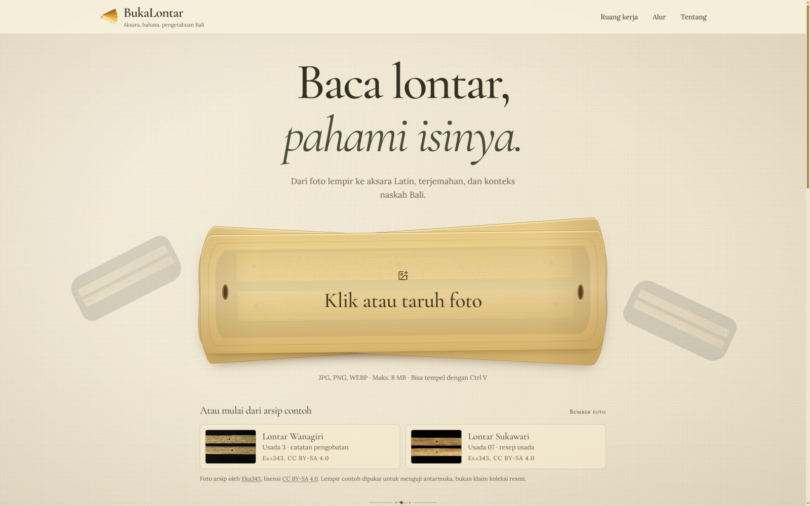
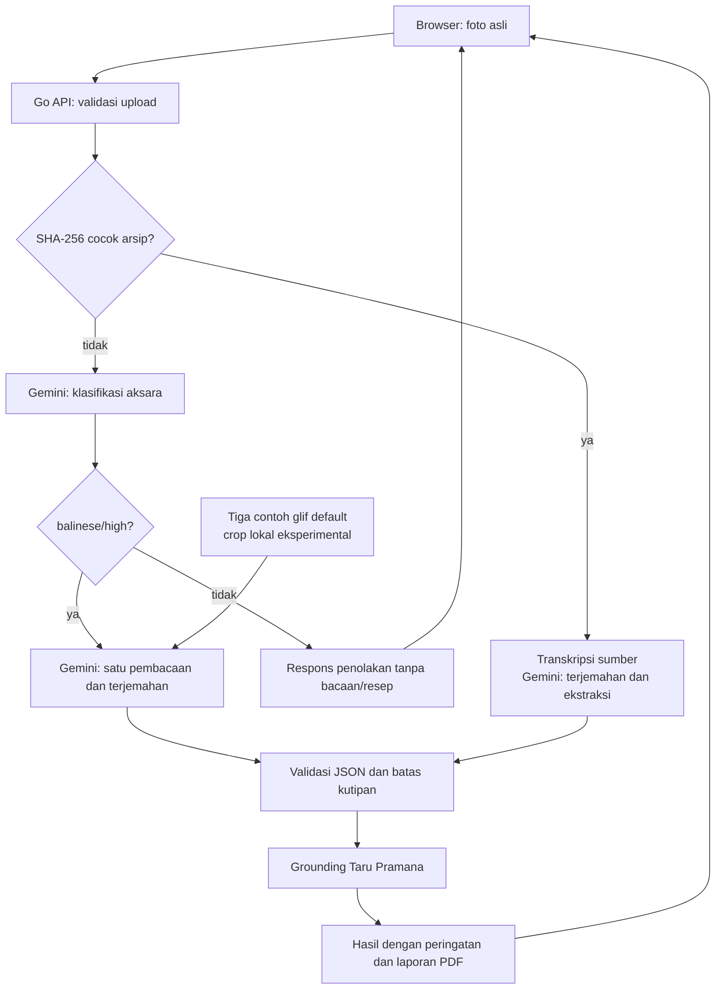

<div align="center">


# BukaLontar

**Baca lontar Bali, dari aksara sampai konteks.**

Aplikasi web eksperimental untuk membantu membaca foto lontar beraksara Bali, menghasilkan usulan transliterasi dan terjemahan, serta menelusuri konteks naskah. Untuk Usadha, aplikasi dapat menampilkan resep yang lolos pemeriksaan kutipan dan pencocokan tanaman dengan basis pengetahuan Taru Pramana. Hasil tetap perlu diperiksa terhadap foto dan oleh ahli.


[Repositori](https://github.com/0xMinomus/bukalontar) | [Dokumentasi](docs/README.md) | [AI Disclosure](docs/AI_DISCLOSURE.md)

Versi final terkini: [`main`](https://github.com/0xMinomus/bukalontar/tree/main). Tag [`v1.1-final-submission`](https://github.com/0xMinomus/bukalontar/tree/v1.1-final-submission) adalah snapshot historis, bukan versi produksi terbaru. [Website](https://www.bukalontar.my.id) | [Status akhir dan pemeriksaan deployment](docs/STATUS.md) | [Perbandingan baseline](docs/AI_EVALUATION.md#upgrade-pengaman-kutipan-dan-pembanding-baseline)

Perbaikan pada `main` setelah tag: empat contoh arsip memakai transkripsi rujukan dengan label terbuka. Tag submission tidak dipindah. [Metode contoh arsip](docs/DATA_SOURCES.md#analisis-berbantuan-transkripsi-rujukan) | [Hasil uji contoh](docs/AI_EVALUATION.md#empat-contoh-arsip-berbantuan-transkripsi).

</div>

---

## Daftar Isi

- [Tentang](#tentang)
- [Screenshot](#screenshot)
- [Masalah dan Target Pengguna](#masalah-dan-target-pengguna)
- [Cakupan Produk](#cakupan-produk)
- [Fitur](#fitur)
- [Cara Kerja AI](#cara-kerja-ai)
- [Arsitektur](#arsitektur)
- [Teknologi](#teknologi)
- [Menjalankan Proyek](#menjalankan-proyek)
- [Struktur Repositori](#struktur-repositori)
- [Data, Sumber, dan Kredit](#data-sumber-dan-kredit)
- [Keamanan dan Privasi](#keamanan-dan-privasi)
- [AI dan Technology Disclosure](#ai-dan-technology-disclosure)
- [Batasan Saat Ini](#batasan-saat-ini)
- [Tim](#tim)
- [Dokumentasi Lanjutan](#dokumentasi-lanjutan)

## Tentang

Lontar adalah warisan tulis Bali yang mencakup banyak genre: Usadha, Kakawin, Babad, Geguritan, tutur, dan naskah lain. Banyak di antaranya belum terbaca oleh generasi muda, peneliti, atau pengunjung museum karena dua lapis hambatan: aksara Bali kuno dan bahasa Kawi.

BukaLontar adalah alat bantu pembacaan lontar berbasis AI, bukan pengganti filolog. Unggah foto lempir untuk memperoleh usulan transliterasi Latin, terjemahan Indonesia dan Inggris, serta informasi sumber jika dapat dikenali. Bahasa Kawi/Jawa Kuno dapat ditulis dengan aksara Bali; bahasa tersebut tidak sama dengan aksara Kawi.

Untuk lontar Usadha, hasilnya diperkaya dengan lapisan khusus: nama tanaman lokal, nama ilmiah, bagian tanaman, bentuk racikan, indikasi, senyawa fitokimia, dan rujukan dari Taru Pramana. Lapisan ini tidak dipaksakan pada naskah yang bukan Usadha.

## Screenshot

<p align="center">
  
</p>

Landing page BukaLontar: unggah satu lempir, mulai dari arsip contoh, lalu baca hasilnya.

## Masalah dan Target Pengguna

**Masalah utama**

- Aksara Bali pada lontar ditulis tanpa spasi dan memakai pasang aksara yang bertumpuk.
- Banyak naskah memakai bahasa Kawi klasik, bukan bahasa Bali sehari-hari.
- Foto lontar sering gelap, aus, atau miring, sehingga pembacaan manual memakan waktu.
- Pengetahuan tanaman obat di lontar Usadha tersebar dan sulit dihubungkan dengan taksonomi modern.

**Target pengguna**

- Pelajar, mahasiswa, dan masyarakat yang ingin membaca lontar Bali.
- Peneliti filologi, sejarah, dan etnobotani.
- Kurator museum, perpustakaan, dan arsip budaya.
- Praktisi herbal serta peneliti fitofarmaka yang bekerja dengan lontar Usadha.

## Cakupan Produk

| Alur | Naskah | Keluaran utama |
| --- | --- | --- |
| Pembacaan lontar umum | Foto lontar beraksara Bali | Usulan transliterasi, terjemahan Indonesia dan Inggris, serta ringkasan ketika teks dapat dibaca |
| Alur Usadha | Foto lontar dengan dugaan resep Usadha | Keluaran umum dan maksimal enam kartu resep yang lolos pemeriksaan kutipan |

Alur Usadha bersifat otomatis berdasarkan isi naskah. Tidak ada klaim bahwa setiap lontar adalah Usadha, dan naskah non-Usadha tetap dapat dibaca sebagai teks.

Contoh landing saat ini: **Usadha Sukawati**, **Usadha Rare Kemenuh**, **Carcan Kucing**, dan **Kakawin Bharatayuda**. Dua contoh pertama memuat racikan pada sisi yang dipilih; dua lainnya menunjukkan naskah non-Usadha. Untuk foto yang byte-nya cocok persis dengan arsip, bacaan Latin berasal dari transkripsi komunitas Wikisource. Gemini menerjemahkan dan mengekstrak isi saat permintaan berlangsung. UI dan PDF menandai **Berbantuan transkripsi rujukan**; ini bukan demonstrasi OCR murni atau bukti akurasi pada foto baru.

## Fitur

### Pembacaan lontar

- Downscale, CLAHE, dan unsharp mask untuk pratinjau browser; API menerima foto asli.
- Usulan transliterasi Latin, dengan penanda bagian tidak terbaca.
- Usulan terjemahan Indonesia dan Inggris.
- Bahasa teks, sumber, dan nomor lempir jika dikenali, serta confidence model yang bukan ukuran akurasi.
- Tampilan hasil yang bisa disalin dan diekspor menjadi laporan PDF.

### Alur Usadha

- Deteksi beberapa resep dalam satu lembar.
- Identifikasi nama tanaman lokal dan pencocokan dengan Taru Pramana.
- Bagian tanaman, sifat tradisional, bentuk racikan, dan indikasi.
- Senyawa fitokimia dan rujukan ilmiah yang tersedia di knowledge base.
- Label "belum tercatat" saat tanaman tidak ditemukan di knowledge base.
- Tautan PubMed dari knowledge base pada kartu dan laporan; pencarian literatur dibedakan dari publikasi tertentu.
- Disclaimer medis dari server, bukan dari model.

### Antarmuka

- Lensa lontar dengan zoom dan mode kontras.
- Pratinjau sebelum analisis.
- Mode mock untuk pengembangan UI tanpa API.
- Tata letak responsif dan laporan cetak.

## Cara Kerja AI

1. Browser menyiapkan pratinjau yang dapat diperjelas, lalu mengirim foto asli ke `POST /api/analyze-manuscript`.
2. Backend memvalidasi ukuran dan tipe file, lalu mencocokkan SHA-256 dengan empat foto arsip. Kecocokan memilih transkripsi rujukan dan genre sumber; bukan nama file atau `source_id`.
3. Foto yang tidak cocok tetap melalui pemeriksaan aksara tanpa katalog atau contoh. Hanya `balinese/high` mencapai pembaca; default `examples` menambahkan tiga contoh glif. Detektor lokal tetap eksperimental, bukan OCR halaman penuh.
4. Gemini 3.8 Flash Low membaca foto baru, atau menerjemahkan dan mengekstrak transkripsi yang dipasok untuk arsip cocok. Bacaan Latin arsip dipertahankan server dari sumber, bukan diganti bacaan model. Tidak ada fallback model atau jawaban hasil analisis yang di-cache.
5. JSON diparse dan divalidasi; satu percobaan perbaikan struktur diperbolehkan.
6. Resep memerlukan kutipan utuh dari lembar pertama yang menyebut tanaman dan bahan tambahan yang diklaim. Sumber kutipan adalah bacaan AI pada foto baru atau transkripsi rujukan pada arsip cocok. Bagian tidak terbaca, elipsis, pengantar, dan lembar lain tidak boleh menjembatani bukti. Arsip Carcan/Kakawin tidak menghasilkan kartu resep.
7. Nama ilmiah, famili, senyawa, dan rujukan berasal dari KB jika cocok. Sifat tradisional mengikuti bacaan, bukan nilai bawaan KB.
8. Frontend dan PDF membedakan analisis foto eksperimental dari analisis berbantuan transkripsi rujukan. Kutipan yang cocok tidak membuktikan terjemahan benar atau racikan aman.

Server menetapkan disclaimer medis dan rujukan KB. Model masih dapat mengarang bacaan beserta kutipan yang tampak konsisten; pengaman tidak menggantikan pemeriksaan ahli.

## Arsitektur



Detail teknis ada di [`docs/ARCHITECTURE.md`](docs/ARCHITECTURE.md). Kontrak respons ada di [`packages/schema/analysis.json`](packages/schema/analysis.json).

## Teknologi

| Layer | Teknologi |
| --- | --- |
| Frontend | React 19, TypeScript, Vite, Tailwind CSS v4, Radix UI, Lucide |
| Pengolahan gambar | HTML5 Canvas API |
| Backend | Go standard library; binary mandiri untuk deployment non-Vercel |
| Gateway AI | 9router dengan endpoint OpenAI-compatible |
| Model | Hanya `ag/gemini-3.8-flash-low` melalui 9router, tanpa fallback model |
| Knowledge base | JSON Taru Pramana yang di-embed dengan `go:embed` |
| Bantuan pembacaan | Detektor teks ridge + LinearSVC HOG dilatih dari DeepLontar; 55 contoh glif ahli di-embed |
| Kontrak | JSON Schema di `packages/schema/analysis.json` |
| Deployment | Vercel Services: `web` (Vite) dan `api` (Go); binary mandiri opsional |

## Menjalankan Proyek

Prasyarat:

- Node.js 22.12 atau lebih baru (Vite juga mendukung Node.js 20.19 pada seri 20.x)
- npm
- Go 1.26 atau lebih baru

```bash
npm install
cp apps/api/.env.example apps/api/.env
# Isi AI_BASE_URL dan AI_API_KEY sesuai instance 9router; pertahankan AI_MODEL=ag/gemini-3.8-flash-low.
```

Terminal pertama:

```bash
make dev-api
```

Terminal kedua:

```bash
npm run dev
```

Buka `http://localhost:5173`.

Build produksi:

```bash
make build
./bin/bukalontar
```

Buka `http://localhost:8080`. Health check tersedia di `GET /health`.

## Deployment URL

- Live MVP: <https://www.bukalontar.my.id>
- Health check: <https://www.bukalontar.my.id/health>
- Hosting: Vercel Services, service `web` dan `api`
- AI gateway: 9router di `https://dashboard.minomus.my.id/v1`

Untuk deployment Vercel, `AI_BASE_URL` harus diisi endpoint publik 9router, bukan `127.0.0.1`. Health check akan mengembalikan `503` bila env tersebut belum masuk ke project.

Pada 12 November 2026, health produksi melaporkan `ok=true`, 10 entri KB, dan model `ag/gemini-3.8-flash-low`. Endpoint tidak melaporkan commit deployment; health yang baik tidak membuktikan versi produksi sama dengan tag submission.

Pengujian:

```bash
cd apps/api
go test ./...
go vet ./...

cd ../..
npm run lint
npm run build
```

## Struktur Repositori

```text
apps/api/          API Go, AI client, validasi, KB, SPA ter-embed
apps/web/          React, preprocessing Canvas, tampilan hasil, laporan PDF
packages/schema/   Kontrak JSON AnalysisResponse
docs/              Konsep, arsitektur, alur Usadha, sumber data, disclosure
```

## Data, Sumber, dan Kredit

- Foto sampel lontar: Eka343 (CC BY-SA 4.0) dan pindaian Carcan dari Internet Archive (PD-ID-exempt). Transkripsi: kontributor Wikisource Bali. Kredit, revisi, crop, dan hash ada di [`apps/web/public/samples/CREDITS.md`](apps/web/public/samples/CREDITS.md).
- Knowledge base Taru Pramana: `apps/api/internal/kb/data/taru-pramana.json`.
- Rujukan naskah dan konteks: [`docs/DATA_SOURCES.md`](docs/DATA_SOURCES.md).
- Font: Cormorant Garamond dan Lora, dibundel lokal; lisensi OFL menyertai aset.
- Library frontend: React, Vite, Tailwind CSS, Radix UI, Lucide, class-variance-authority, clsx, tailwind-merge.
- Gateway AI: 9router, hanya Gemini 3.8 Flash Low tanpa fallback model.

## Keamanan dan Privasi

- API key hanya dibaca dari environment server.
- `.env` dan varian lokal di-ignore. Hanya `.env.example` yang masuk repository.
- Tidak ada data pribadi, data pasien, atau credential demo di repository.
- Backend memproses gambar di memori. Foto yang tidak cocok dengan arsip dikirim ke gateway dan penyedia AI; untuk arsip cocok, hanya teks rujukan dikirim. Retensi pihak ketiga belum diverifikasi. Browser menyimpan foto dan hasil sesi aktif di IndexedDB.
- Endpoint 9router tidak boleh dibuka ke publik tanpa autentikasi.
- Laporan kerentanan mengikuti [`SECURITY.md`](SECURITY.md).

## AI dan Technology Disclosure

Disclosure lengkap ada di [`docs/AI_DISCLOSURE.md`](docs/AI_DISCLOSURE.md). AI coding assistant membantu implementasi dan dokumentasi. Percakapan dan konfigurasi rahasia agen tidak disertakan; prompt produk dan keluaran eksperimen model disimpan untuk reproduksi. Keputusan teknis dan source code tetap menjadi tanggung jawab tim.

## Evaluasi AI

[Laporan evaluasi final](docs/AI_EVALUATION.md) mencatat perbandingan model, latensi, konsistensi, keluaran mentah, dan keterbatasan penilaian. Runner Go menggunakan jalur analisis aplikasi yang sebenarnya; tidak menyajikan jawaban cache.

Korpus lokal berisi 200 citra asli lontar Bali dari DeepLontar v2, dengan manifest, checksum, dan lisensi CC BY 4.0. Satu berkas anotasi dikarantina karena ID kelas di luar spesifikasi. Data ini dipakai melatih detektor teks dan pengenal glif lokal; bobot model bahasa tidak diubah. Lihat [sumber data](docs/DATA_SOURCES.md) dan [dokumen training OCR](docs/OCR_TRAINING.md).

### Hasil akhir dibanding baseline

Upgrade terakhir memperketat pengaman resep, bukan meningkatkan kemampuan OCR. Pada enam kasus batas terkontrol, resep tidak didukung yang lolos turun dari 6/6 menjadi 0/6; tiga kutipan utuh tetap diterima 3/3. Angka ini bukan akurasi pembacaan foto.

Pada batch empat gambar × dua pengulangan, baseline dan kandidat sama-sama menerima foto Bali 4/4 dan menolak pembanding 4/4. Pembanding Kawi adalah gambar cetak, bukan foto lontar; sampel kecil dan label aksara belum disertifikasi ahli. Tidak ada bukti peningkatan akurasi, konsistensi, atau kecepatan pembacaan. Bukti teknis terakhir: 51 tes backend lulus, build produksi berhasil, dan upload foto melalui API lokal menghasilkan HTTP 200. Rincian dan seluruh keluaran ada pada [evaluasi upgrade](docs/AI_EVALUATION.md#upgrade-pengaman-kutipan-dan-pembanding-baseline).

## Batasan Saat Ini

- Hasil AI dapat keliru atau berbeda antarpercobaan. Periksa bacaan dan resep terhadap sumber; hasil bukan edisi filologi terverifikasi atau rekomendasi pengobatan.
- Kualitas pembacaan bergantung pada foto. Deteksi aksara juga dapat salah menerima atau menolak gambar.
- Empat contoh arsip memakai transkripsi rujukan, bukan OCR baru. Pembacaan foto lain masih eksperimental.
- Basis pengetahuan tanaman terbatas pada entri Taru Pramana yang dikurasi.

## Tim

- **Andika Putra**: developer dan pemelihara repository.

## Dokumentasi Lanjutan

- [Indeks dokumentasi](docs/README.md)
- [Konsep produk](docs/PROJECT_CONCEPT.md)
- [Arsitektur dan alur data](docs/ARCHITECTURE.md)
- [Alur Usadha](docs/USADHA_MODE.md)
- [Sumber data dan kredit](docs/DATA_SOURCES.md)
- [AI dan Technology Disclosure](docs/AI_DISCLOSURE.md)
- [Evaluasi AI](docs/AI_EVALUATION.md)
- [Detektor teks dan pengenal glif](docs/OCR_TRAINING.md)
- [Proposal PDF](docs/proposal/AIWIC2026_0xAlpha_BukaLontar.pdf)
- [Panduan kontribusi](CONTRIBUTING.md)
- [Kebijakan keamanan](SECURITY.md)

---

Dibuat untuk **Bali DigiFest 2026, AI Web Innovation Challenge**.
