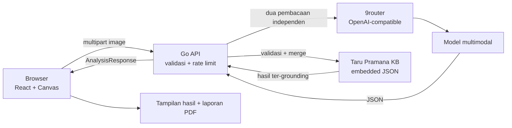

<div align="center">


# BukaLontar

**Baca lontar Bali, dari aksara sampai konteks.**

Aplikasi web untuk membaca citra lontar Bali, menghasilkan transliterasi dan terjemahan, serta menampilkan konteks naskah. Untuk lontar Usadha, BukaLontar menambahkan ekstraksi resep tanaman obat yang terhubung ke basis pengetahuan Taru Pramana.


[Repositori](https://github.com/0xMinomus/bukalontar) | [Dokumentasi](docs/README.md) | [AI Disclosure](docs/AI_DISCLOSURE.md)

</div>

---

## Daftar Isi

- [Tentang](#tentang)
- [Screenshot](#screenshot)
- [Masalah dan Target Pengguna](#masalah-dan-target-pengguna)
- [Cakupan Produk](#cakupan-produk)
- [Fitur](#fitur)
- [Cara Kerja AI](#cara-kerja-ai)
- [Arsitektur](#arsitektur)
- [Teknologi](#teknologi)
- [Menjalankan Proyek](#menjalankan-proyek)
- [Struktur Repositori](#struktur-repositori)
- [Data, Sumber, dan Kredit](#data-sumber-dan-kredit)
- [Keamanan dan Privasi](#keamanan-dan-privasi)
- [AI dan Technology Disclosure](#ai-dan-technology-disclosure)
- [Batasan Saat Ini](#batasan-saat-ini)
- [Tim](#tim)
- [Dokumentasi Lanjutan](#dokumentasi-lanjutan)

## Tentang

Lontar adalah warisan tulis Bali yang mencakup banyak genre: Usadha, Kakawin, Babad, Geguritan, tutur, dan naskah lain. Banyak di antaranya belum terbaca oleh generasi muda, peneliti, atau pengunjung museum karena dua lapis hambatan: aksara Bali kuno dan bahasa Kawi.

BukaLontar adalah pembaca lontar berbasis AI. Unggah foto lempir, lalu aplikasi menampilkan transliterasi Latin, terjemahan Indonesia dan Inggris, serta informasi sumber naskah. Alur ini berlaku untuk lontar Bali secara umum.

Untuk lontar Usadha, hasilnya diperkaya dengan lapisan khusus: nama tanaman lokal, nama ilmiah, bagian tanaman, bentuk racikan, indikasi, senyawa fitokimia, dan rujukan dari Taru Pramana. Lapisan ini tidak dipaksakan pada naskah yang bukan Usadha.

## Screenshot

<p align="center">
  
</p>

Landing page BukaLontar: unggah satu lempir, mulai dari arsip contoh, lalu baca hasilnya.

## Masalah dan Target Pengguna

**Masalah utama**

- Aksara Bali pada lontar ditulis tanpa spasi dan memakai pasang aksara yang bertumpuk.
- Banyak naskah memakai bahasa Kawi klasik, bukan bahasa Bali sehari-hari.
- Foto lontar sering gelap, aus, atau miring, sehingga pembacaan manual memakan waktu.
- Pengetahuan tanaman obat di lontar Usadha tersebar dan sulit dihubungkan dengan taksonomi modern.

**Target pengguna**

- Pelajar, mahasiswa, dan masyarakat yang ingin membaca lontar Bali.
- Peneliti filologi, sejarah, dan etnobotani.
- Kurator museum, perpustakaan, dan arsip budaya.
- Praktisi herbal serta peneliti fitofarmaka yang bekerja dengan lontar Usadha.

## Cakupan Produk

| Alur | Naskah | Keluaran utama |
| --- | --- | --- |
| Pembacaan lontar umum | Semua lontar Bali yang dapat dibaca | Transliterasi, terjemahan Indonesia, terjemahan Inggris, ringkasan isi |
| Alur Usadha | Lontar Usadha | Semua keluaran umum, ditambah satu atau beberapa kartu resep tanaman obat |

Alur Usadha bersifat otomatis berdasarkan isi naskah. Tidak ada klaim bahwa setiap lontar adalah Usadha, dan naskah non-Usadha tetap dapat dibaca sebagai teks.

## Fitur

### Pembacaan lontar

- Preprocessing gambar di browser: downscale, CLAHE, dan unsharp mask.
- Transkripsi aksara Bali ke Latin.
- Terjemahan Indonesia dan Inggris.
- Label sumber, nomor lempir, dan tingkat keterbacaan.
- Tampilan hasil yang bisa disalin dan diekspor menjadi laporan PDF.

### Alur Usadha

- Deteksi beberapa resep dalam satu lembar.
- Identifikasi nama tanaman lokal dan pencocokan dengan Taru Pramana.
- Bagian tanaman, sifat tradisional, bentuk racikan, dan indikasi.
- Senyawa fitokimia dan rujukan ilmiah yang tersedia di knowledge base.
- Label "belum tercatat" saat tanaman tidak ditemukan di knowledge base.
- Disclaimer medis dari server, bukan dari model.

### Antarmuka

- Lensa lontar dengan zoom dan mode kontras.
- Pratinjau sebelum analisis.
- Mode mock untuk pengembangan UI tanpa API.
- Tata letak responsif dan laporan cetak.

## Cara Kerja AI

1. Browser mengecilkan dan mempertajam foto lontar.
2. Gambar dikirim ke `POST /api/analyze-manuscript`.
3. Backend memvalidasi ukuran dan tipe file, lalu mengirim gambar ke model multimodal.
4. Dua pembacaan independen dijalankan untuk mengurangi hasil yang terpotong.
5. Setiap respons diparse sebagai JSON, divalidasi, dan diperbaiki satu kali bila schema tidak sesuai.
6. Hasil digabung. Untuk lontar Usadha, resep digabung dan dideduplikasi. Untuk naskah umum, daftar resep dapat kosong.
7. Nama ilmiah, famili, senyawa, dan rujukan digrounding ke Taru Pramana. Field yang tidak cocok dikosongkan, bukan ditebak.
8. Frontend menampilkan hasil bacaan dan, bila ada, kartu resep Usadha.

Model tidak dipakai untuk menulis disclaimer, membuat sitasi palsu, atau mengisi taksonomi yang tidak ada di knowledge base.

## Arsitektur



Detail teknis ada di [`docs/ARCHITECTURE.md`](docs/ARCHITECTURE.md). Kontrak respons ada di [`packages/schema/analysis.json`](packages/schema/analysis.json).

## Teknologi

| Layer | Teknologi |
| --- | --- |
| Frontend | React 19, TypeScript, Vite, Tailwind CSS v4, Radix UI, Lucide |
| Pengolahan gambar | HTML5 Canvas API |
| Backend | Go standard library; binary mandiri untuk deployment non-Vercel |
| Gateway AI | 9router dengan endpoint OpenAI-compatible |
| Model | Model multimodal melalui 9router, fallback opsional |
| Knowledge base | JSON Taru Pramana yang di-embed dengan `go:embed` |
| Kontrak | JSON Schema di `packages/schema/analysis.json` |
| Deployment | Vercel Services: `web` (Vite) dan `api` (Go); binary mandiri opsional |

## Menjalankan Proyek

Prasyarat:

- Node.js 20 atau lebih baru
- npm
- Go 1.24 atau lebih baru

```bash
npm install
cp apps/api/.env.example apps/api/.env
# Isi AI_BASE_URL, AI_MODEL, dan AI_API_KEY sesuai instance 9router.
```

Terminal pertama:

```bash
make dev-api
```

Terminal kedua:

```bash
npm run dev
```

Buka `http://localhost:5173`.

Build produksi:

```bash
make build
./bin/bukalontar
```

Buka `http://localhost:8080`. Health check tersedia di `GET /health`.

## Deployment URL

- Live MVP: <https://bukalontar.my.id>
- Health check: <https://bukalontar.my.id/health>
- Hosting: Vercel Services, service `web` dan `api`
- AI gateway: 9router di `https://dashboard.minomus.my.id/v1`

Untuk deployment Vercel, `AI_BASE_URL` harus diisi endpoint publik 9router, bukan `127.0.0.1`. Health check akan mengembalikan `503` bila env tersebut belum masuk ke project.

Pengujian:

```bash
cd apps/api
go test ./...
go vet ./...

cd ../..
npm run lint
npm run build
```

## Struktur Repositori

```text
apps/api/          API Go, AI client, validasi, KB, SPA ter-embed
apps/web/          React, preprocessing Canvas, tampilan hasil, laporan PDF
packages/schema/   Kontrak JSON AnalysisResponse
docs/              Konsep, arsitektur, alur Usadha, sumber data, disclosure
```

## Data, Sumber, dan Kredit

- Foto sampel lontar: Eka343, CC BY-SA 4.0. Detail di [`apps/web/public/samples/CREDITS.md`](apps/web/public/samples/CREDITS.md).
- Knowledge base Taru Pramana: `apps/api/internal/kb/data/taru-pramana.json`.
- Rujukan naskah dan konteks: [`docs/DATA_SOURCES.md`](docs/DATA_SOURCES.md).
- Font: Cormorant Garamond dan Lora melalui Google Fonts.
- Library frontend: React, Vite, Tailwind CSS, Radix UI, Lucide, class-variance-authority, clsx, tailwind-merge.
- Gateway AI: 9router. Fallback provider bersifat opsional.

## Keamanan dan Privasi

- API key hanya dibaca dari environment server.
- `.env` dan varian lokal di-ignore. Hanya `.env.example` yang masuk repository.
- Tidak ada data pribadi, data pasien, atau credential demo di repository.
- Gambar diproses di memori dan tidak disimpan sebagai file oleh backend.
- Endpoint 9router tidak boleh dibuka ke publik tanpa autentikasi.
- Laporan kerentanan mengikuti [`SECURITY.md`](SECURITY.md).

## AI dan Technology Disclosure

Disclosure lengkap ada di [`docs/AI_DISCLOSURE.md`](docs/AI_DISCLOSURE.md). AI coding assistant digunakan untuk membantu implementasi dan dokumentasi. Prompt, log, dan konfigurasi agen tidak disimpan di repository. Keputusan teknis dan source code tetap menjadi tanggung jawab tim.

## Batasan Saat Ini

- Output model tidak deterministik. Dua permintaan berturut-turut dapat membaca baris atau resep yang berbeda.
- Kualitas pembacaan bergantung pada kualitas foto, pencahayaan, dan ketajaman goresan.
- Untuk naskah non-Usadha, hasil terstruktur masih terbatas pada bacaan, terjemahan, dan ringkasan. Klasifikasi genre yang mendalam belum tersedia.
- Knowledge base masih terbatas pada entri Taru Pramana yang dikurasi.
- Model membutuhkan gateway AI yang tersedia saat demo.
- Belum ada autentikasi, database eksternal, atau akun demo.
- Deployment publik berjalan di Vercel Services. `AI_BASE_URL` Vercel harus mengarah ke endpoint publik 9router agar health check `ok`.

## Tim

- **Andika Putra**: developer dan pemelihara repository.

## Dokumentasi Lanjutan

- [Indeks dokumentasi](docs/README.md)
- [Konsep produk](docs/PROJECT_CONCEPT.md)
- [Arsitektur dan alur data](docs/ARCHITECTURE.md)
- [Alur Usadha](docs/USADHA_MODE.md)
- [Sumber data dan kredit](docs/DATA_SOURCES.md)
- [AI dan Technology Disclosure](docs/AI_DISCLOSURE.md)
- [Proposal PDF](docs/proposal/AIWIC2026_0xAlpha_BukaLontar.pdf)
- [Panduan kontribusi](CONTRIBUTING.md)
- [Kebijakan keamanan](SECURITY.md)

---

Dibuat untuk **Bali DigiFest 2026, AI Web Innovation Challenge**.
