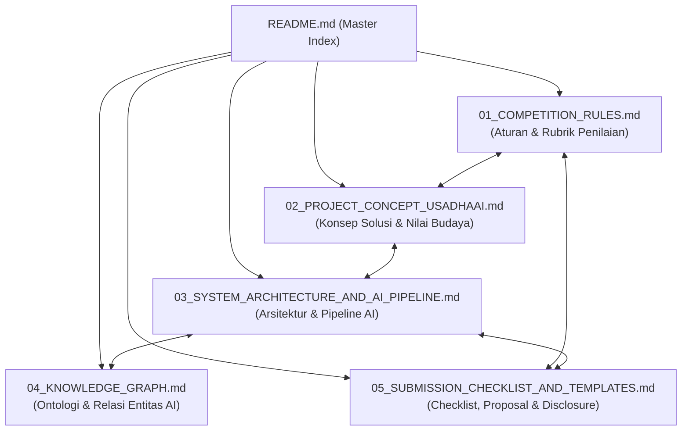

# UsadhaAI — Project Master Knowledge Base
**Bali DigiFest 2026: AI Web Innovation Challenge**
*Theme: "BUILD WITH AI, SOLVE FOR BALI" — Think • Build • Demonstrate • Impact*

Welcome to the central knowledge hub for **UsadhaAI** (AI Paleografi, Preservasi Naskah Kuno, dan Ekstraksi Etnofarmakope Lontar Tradisional Bali).

---

## 🗺️ Knowledge Graph & Navigation Index

Dokumentasi ini dirancang saling terhubung (*interconnected graph*) di dalam Obsidian agar mempermudah pemahaman arsitektur, kepatuhan kompetisi, dan eksekusi teknis.

### 📂 Dokumen Utama
1. [**01. Competition Rules & Guidelines**](docs/01_COMPETITION_RULES.md)
   * Ringkasan aturan resmi, technical gate (PASS/FAIL), bobot rubrik Tahap 1 & Final, aturan GitHub, deployment, dan verifikasi teknis.
2. [**02. Project Concept — UsadhaAI**](docs/02_PROJECT_CONCEPT_USADHAAI.md)
   * Penjelasan masalah *The Double Barrier Problem* (Aksara Bali + Bahasa Kawi), data sensus Disbud Bali (>25.000 lontar), katalog Gedong Kirtya (Va. 1384/10 *Taru Pramana*), dan validasi bio-farmasi modern.
3. [**03. System Architecture & AI Pipeline**](docs/03_SYSTEM_ARCHITECTURE_AND_AI_PIPELINE.md)
   * Alur teknis end-to-end: Preprocessing visual $\rightarrow$ Multimodal Vision (Gemini 3.8 Flash) $\rightarrow$ Ekstraksi Entitas Terstruktur $\rightarrow$ Mapping Taksonomi Botani Modern $\rightarrow$ UI Interaktif.
4. [**04. Explicit Knowledge Graph & Ontologies**](docs/04_KNOWLEDGE_GRAPH.md)
   * Pemetaan relasi antar-entitas: Aturan Lomba $\leftrightarrow$ Sensus Lontar $\leftrightarrow$ Bahasa Kawi $\leftrightarrow$ Fitur MVP $\leftrightarrow$ Model AI $\leftrightarrow$ Dataset Botani.
5. [**05. Submission Checklist & Templates**](docs/05_SUBMISSION_CHECKLIST_AND_TEMPLATES.md)
   * Template Proposal 5 halaman (Lampiran A), Template README (Lampiran B), Template AI & Technology Disclosure (Lampiran C), dan Checklist verifikasi.

---

## ⚡ Quick Project Summary

| Parameter | Spesifikasi Proyek |
| :--- | :--- |
| **Nama Proyek** | **UsadhaAI** (*Intelligent Balinese Palm-Leaf Manuscript Paleography & Ethnomedicinal Knowledge Engine*) |
| **Kategori Lomba** | AI Web Innovation Challenge — Bali DigiFest 2026 |
| **Ruang Lingkup** | *Bali Smart Society (Pilar Budaya & Komunitas)* & *Education / Smart Information Systems* |
| **Masalah Inti** | **The Double Barrier Problem**: Naskah lontar pengobatan Bali terkunci oleh 2 lapis hambatan: (1) Aksara Bali kuno tanpa spasi, dan (2) Bahasa Kawi (Jawa Kuno Klasik). |
| **Prinsip AI** | **Material AI**: Multimodal Vision + LLM Reasoning + Structured Bio-Entity Extraction + Botanical Knowledge Graph Mapping |
| **Target MVP** | Web Application responsif, clean-start testing, interactive high-res lontar lens, instant transliteration, and digital ethnopharmacopeia card |
| **Tech Stack** | React 19 + TypeScript + Vite, Tailwind CSS, Go (single binary + embedded SPA), Gemini 3.8 Flash via 9router/Command Code, Taru Pramana Knowledge Base, Docker Compose + Caddy di VM |

---

*Lihat rincian lengkap konsep proyek di [docs/02_PROJECT_CONCEPT_USADHAAI.md](docs/02_PROJECT_CONCEPT_USADHAAI.md).*
