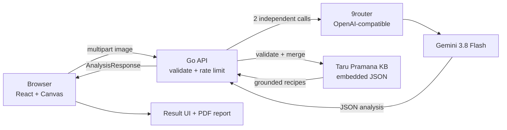

# BukaLontar

**Bali DigiFest 2026 — AI Web Innovation Challenge**

BukaLontar adalah aplikasi web untuk membaca citra manuskrip lontar Usadha Bali, menghasilkan transliterasi dan terjemahan, lalu mengekstrak tanaman obat, bagian yang dipakai, cara racik, dan rujukan farmakologi modern.

Repository ini adalah source code MVP yang dapat dijalankan dan diuji. Tidak ada API key, token, atau data pribadi di dalam repository.

## Description

Lontar Usadha menyimpan pengetahuan pengobatan tradisional Bali, tetapi terkunci oleh dua hambatan: aksara Bali kuno yang ditulis tanpa spasi dan bahasa Kawi klasik. BukaLontar memakai model multimodal untuk mengubah foto lontar menjadi:

- transliterasi Latin,
- terjemahan Indonesia dan Inggris,
- daftar resep tanaman,
- nama lokal Bali, taksonomi botani, bagian tanaman, dan bentuk racikan,
- senyawa fitokimia serta rujukan ilmiah yang tersedia di knowledge base.

Model AI adalah bagian material dari alur produk: tanpa inferensi multimodal, citra lontar tidak dapat diubah menjadi data terstruktur yang dapat dicari.

## Problem & Target User

**Masalah:** Banyak naskah lontar Usadha rusak, sulit dibaca, dan hanya dipahami oleh segelintir filolog. Proses manual membutuhkan waktu lama dan tidak dapat diskalakan untuk ribuan lembar.

**Target user:**

- pelajar dan generasi muda Bali yang ingin membaca warisan tulis leluhur;
- peneliti etnofarmasi dan botani;
- praktisi herbal serta UMKM wellness;
- kurator museum, perpustakaan, dan arsip budaya.

## Key Features

- **Lontar image preprocessing** di browser: downscale, CLAHE, dan unsharp mask sebelum dikirim.
- **Pembacaan multimodal**: transliterasi, terjemahan Indonesia, dan terjemahan Inggris.
- **Multi-resep per lembar**: satu lembar dapat memuat beberapa resep; semuanya ditampilkan sebagai kartu terpisah.
- **Knowledge-base grounding**: nama ilmiah, family, senyawa, dan rujukan diambil dari Taru Pramana KB saat cocok; field yang tidak terverifikasi tidak diisi dengan klaim palsu.
- **Hasil yang dapat diunduh**: laporan cetak/PDF berisi seluruh resep, terjemahan, rujukan, dan disclaimer.
- **Mode mock** untuk pengembangan UI tanpa API.

## Tech Stack

| Layer | Teknologi |
| --- | --- |
| Frontend | React 19, TypeScript, Vite, Tailwind CSS v4, Radix UI, Lucide |
| Image processing | HTML5 Canvas API |
| Backend | Go standard library (`net/http`), single binary |
| AI gateway | 9router, OpenAI-compatible endpoint |
| AI model | Gemini 3.8 Flash (`ag/gemini-3.8-flash-low`), fallback `google/gemini-3.8-flash` via Command Code |
| Knowledge base | Embedded JSON, Taru Pramana (`go:embed`) |
| Contract | JSON Schema di `packages/schema/analysis.json` |
| Hosting | Satu binary Go dengan SPA ter-embed; URL publik belum dikonfigurasi |

## AI Implementation

1. Browser mengirim foto lontar ke `POST /api/analyze-manuscript`.
2. Backend memvalidasi tipe dan ukuran gambar, lalu memanggil model dua kali secara independen.
3. Setiap hasil diparse sebagai JSON, divalidasi, dan diperbaiki sekali jika schema tidak sesuai.
4. Dua hasil digabung menjadi daftar resep (maksimal 6, deduplikasi berdasarkan nama tanaman).
5. Nama ilmiah, family, senyawa, dan rujukan digrounding ke Taru Pramana KB.
6. Disclaimer medis selalu ditulis oleh server, bukan oleh model.

Konfigurasi model dan endpoint ada di environment variable. Kunci API tidak pernah dikirim ke frontend dan tidak disimpan di repository.

## Architecture / Data Flow



Detail teknis: [`docs/ARCHITECTURE.md`](docs/ARCHITECTURE.md). Schema respons: [`packages/schema/analysis.json`](packages/schema/analysis.json).

## Installation / Run Instructions

Prasyarat: Node.js 20+, npm, Go 1.24+.

```bash
npm install
cp apps/api/.env.example apps/api/.env
# Isi AI_BASE_URL, AI_MODEL, dan AI_API_KEY sesuai instance 9router.
```

Terminal 1 — API:

```bash
make dev-api
```

Terminal 2 — frontend:

```bash
npm run dev
```

Buka `http://localhost:5173`.

Build produksi (frontend di-embed ke binary Go):

```bash
make build
./bin/bukalontar
```

Buka `http://localhost:8080`. Health check: `GET /health`.

## Deployment URL

- **Live MVP:** belum tersedia pada commit ini. Aplikasi saat ini diuji secara lokal di `http://localhost:8080`.
- **Health check lokal:** `http://localhost:8080/health`
- **Repository:** <https://github.com/0xMinomus/bukalontar>

URL publik harus diisi sebelum submission. Jangan mengarang URL atau menaruh kredensial demo di repository.

## Team Members

- **Andika Putra** — developer dan pemelihara repository.

## Known Limitations

- Output model tidak deterministik. Dua request berturut-turut dapat membaca baris atau resep yang berbeda; multi-resep menampilkan seluruh hasil yang ditemukan, bukan menjamin hasil identik.
- Kualitas pembacaan bergantung pada kualitas foto, pencahayaan, dan ketajaman goresan lontar.
- Model default berjalan melalui 9router lokal; deployment publik membutuhkan gateway AI yang tersedia 24/7.
- Knowledge base masih terbatas pada entri Taru Pramana yang dikurasi; tanaman di luar KB diberi label belum terverifikasi.
- Belum ada autentikasi, database eksternal, atau akun demo karena aplikasi tidak menyimpan data pengguna.
- Belum ada URL deployment publik pada commit ini.

## Third-party Resources / Credits

- Foto sampel lontar: Eka343, CC BY-SA 4.0 — lihat [`apps/web/public/samples/CREDITS.md`](apps/web/public/samples/CREDITS.md).
- Font: Cormorant Garamond dan Lora via Google Fonts.
- Library frontend: React, Vite, Tailwind CSS, Radix UI, Lucide, class-variance-authority, clsx, tailwind-merge.
- AI gateway: 9router; fallback Command Code Provider API.
- Knowledge base: Taru Pramana, dikurasi di `apps/api/internal/kb/data/taru-pramana.json`. Sumber dan batasan dijelaskan di [`docs/PROJECT_CONCEPT.md`](docs/PROJECT_CONCEPT.md).

## AI & Technology Disclosure

Disclosure lengkap ada di [`docs/AI_DISCLOSURE.md`](docs/AI_DISCLOSURE.md). AI coding assistant digunakan untuk membantu implementasi dan dokumentasi; prompt, log, dan konfigurasi agen tidak disimpan di repository. Keputusan teknis dan source code tetap menjadi tanggung jawab tim.

## Repository Layout

```text
apps/api/          Go API, AI client, KB, validation, embedded SPA
apps/web/          React frontend, Canvas preprocessing, result UI, PDF report
packages/schema/   JSON contract for AnalysisResponse
docs/              Project concept, architecture, AI disclosure
```

## Security

- `.env` dan seluruh varian lokal di-ignore; hanya `.env.example` yang boleh masuk repository.
- `.env.example` tidak berisi API key, token, password, atau credential.
- Tidak ada data pribadi atau data pasien dalam repository.
- Jangan commit file konfigurasi agen, log lokal, atau state editor.
