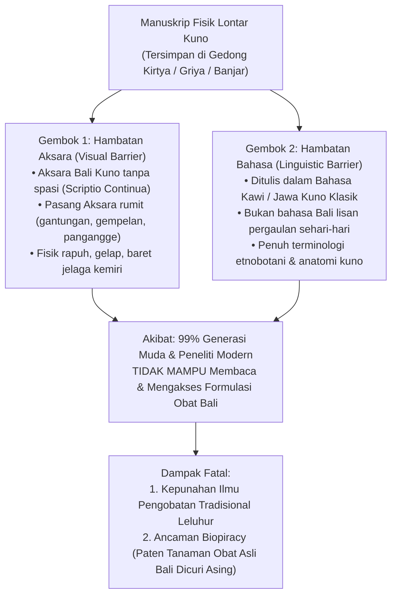
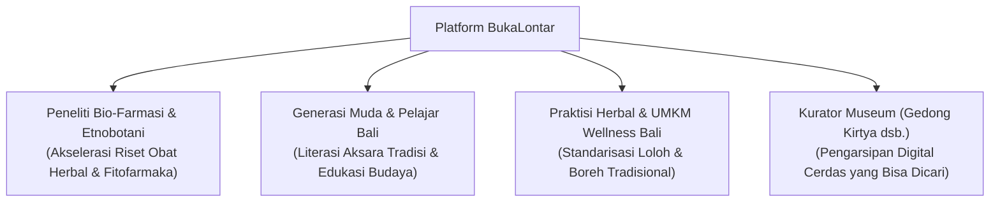

# Project Concept: BukaLontar
**Intelligent Balinese Palm-Leaf Manuscript Paleography & Ethnomedicinal Knowledge Engine**
*Solusi AI untuk Pelestarian Manuskrip Kuno & Ekstraksi Farmakope Tradisional Bali*

---

## 1. Problem & Background (Latar Belakang Masalah)

Pulau Bali memiliki salah satu kekayaan peradaban literasi manuskrip daun lontar (*rontal*) terbesar di Asia Tenggara. Berdasarkan data resmi sensus dan konservasi naskah kuno:
* **Dinas Kebudayaan Provinsi Bali (Tim Penyuluh Bahasa Bali):** Telah mendata, membersihkan, dan mengidentifikasi **lebih dari 25.000 cakep naskah lontar** milik masyarakat di 9 kabupaten/kota di Bali.
* **UPTD Gedong Kirtya (Singaraja, Buleleng):** Perpustakaan lontar tertua di Bali (berdiri sejak 1928) menyimpan lebih dari **1.750 cakep naskah lontar asli**, di mana **Kelompok Va (Usadha)** secara khusus menampung ratusan judul naskah kedokteran tradisional Bali.

Namun, kekayaan intelektual leluhur ini menghadapi ancaman kepunahan kritis akibat fenomena yang kami rumuskan sebagai **The Double Barrier Problem (Dua Lapis Hambatan)**:

---

## 2. Fakta Budaya & Linguistik: Mengapa Lontar Bali Berbahasa Kawi?

> [!NOTE]
> **Fakta Kunci untuk Dewan Juri:**
> Banyak orang awam salah kaprah mengira lontar di Bali ditulis dalam bahasa Bali pergaulan sehari-hari. Faktanya:
> * **Aksaranya:** **100% Aksara Bali** (aksara tradisi Bali).
> * **Bahasanya:** **Bahasa Kawi (Jawa Kuno Klasik) & Bali Alus**.

### Mengapa Bahasa Kawi Menjadi Bahasa Resmi Lontar Bali?
1. **Peradaban Pasca-Majapahit:** Ketika kerajaan Majapahit runtuh pada abad ke-15, para cendekiawan, pendeta, dan bangsawan mengungsi ke Bali membawa ribuan karya sastra dan ilmu kedokteran kuno. Bali menjadi satu-satunya wilayah di dunia yang menjaga dan melestarikan naskah-naskah Kawi (bahkan naskah *Kakawin Sutasoma* dan *Nagarakretagama* ditemukan di Bali/Lombok).
2. **Bahasa Ilmu Pengetahuan & Liturgi:** Di Bali, Bahasa Kawi memiliki kedudukan seperti bahasa Latin bagi bangsa Eropa atau Sanskerta bagi India. Semua mantra pendeta (*Pedanda*), kidung pura, hukum adat (*Awig-Awig/Kutaramanawa*), dan lontar pengobatan (*Usadha*) ditulis dalam bahasa Kawi.
3. **Mengapa Ini Justru Masalah Utama yang Harus Diselesaikan AI?**
   Karena adanya perbedaan antara aksara dan bahasa inilah, anak muda Bali maupun akademisi tidak bisa membaca naskah lontar Usadha. **BukaLontar hadir memecahkan kedua gembok ini sekaligus**: membaca aksara Bali-nya secara visual $\rightarrow$ menerjemahkan bahasa Kawi-nya secara semantik ke Bahasa Indonesia, Bali Alus, dan istilah biologi modern.

---

## 3. Data Katalog Resmi Lontar Usadha di Bali

Berikut adalah data naskah nyata yang tersimpan di museum dan balai budaya di Bali, membuktikan bahwa naskah ini nyata dan memiliki spesialisasi medis yang sangat terstruktur:

| Nama Lontar | Nomor Katalog Gedong Kirtya | Spesialisasi Medis Tradisional |
| :--- | :--- | :--- |
| **Lontar Taru Pramana** | No. `Va. 1384/10` | Ensiklopedia etnobotani (khasiat 100+ tanaman obat Bali). |
| **Lontar Usadha Rare** | No. `Va. 1391/11` | Pediatri (kesehatan ibu, bayi, dan anak-anak). |
| **Lontar Usadha Tiwang** | No. `Va. 1389/9` | Neurologi & spasme (penyakit kejang, saraf, kram otot). |
| **Lontar Usadha Tuju** | No. `Va. 1380/6` | Reumatologi (rematik, asam urat, linu persendian). |
| **Lontar Usadha Buduh** | No. `Va. 1395/15` | Psikiatri (gangguan kejiwaan dan kesehatan mental). |
| **Lontar Usadha Kacacar** | Koleksi Pusdok Kebudayaan Bali | Dermatologi & infeksi (penyakit cacar, campak, kulit). |

---

## 4. Bukti Teks Asli & Pembuktian Bio-Farmasi Modern

Naskah *Lontar Taru Pramana* ditulis dengan format personifikasi puitis di mana setiap tanaman berbicara memaparkan sifat rasa (*panes, tis, dumelada*) dan khasiatnya:

### Studi Kasus 1: Taru Sotong (Pohon Jambu Biji) untuk Penyakit Diare (*Mising*)
* **Teks Asli Lontar (Transliterasi Bahasa Kawi):**
  > *"Tityang taru sotong, daging anget, rasa sepet, dados anggen tamba pangemped mising, sa, muncuk tityange ulig, anggen papuser ring pungsed, ra, katumbar bolong, 3, lunak."*
* **Terjemahan Bahasa Indonesia:**
  > *"Hamba Pohon Jambu Biji (Sotong), sifat daging buah hamba hangat, rasanya sepat, dapat dipergunakan sebagai obat penahan mencret (diare). Sarana: ambil pucuk daun hamba kemudian ditumbuk/diulek, lalu ditempelkan pada pusar. Ramuan pelengkap: campurkan 3 butir ketumbar bolong dan asam jawa."*
* **Validasi Bio-Farmasi Ilmiah:**
  Pucuk daun jambu biji (*Psidium guajava*) terbukti secara klinis mengandung senyawa *tannin* dan *quercetin* yang bersifat antimikroba (menghambat bakteri *E. coli*) dan antispasmodik (meredakan kontraksi usus).

### Studi Kasus 2: Taru Pule (Pohon Pule) untuk Sakit Perut Mendadak (*Cika*)
* **Teks Asli Lontar (Transliterasi Bahasa Kawi):**
  > *"Tityang taru pule, daging tis, kulit getep panes, dados anggen tamba cika, sa, babakan tityang kaurab adas, temutitis, ulig anggen boreh..."*
* **Terjemahan Bahasa Indonesia:**
  > *"Hamba Pohon Pule, getah/daging hamba sejuk, kulit batang hamba hangat, dapat digunakan sebagai obat kram perut/kolik mendadak (cika). Sarana: kulit kayu hamba dicampur adas dan temutitis (rimpang kunyit kecil), diulek lalu dibalurkan sebagai boreh."*
* **Validasi Bio-Farmasi Ilmiah:**
  Kulit batang pule (*Alstonia scholaris*) mengandung alkaloid *echitamine* dan *alstonine* yang memiliki efek analgesik (antinyeri) dan antipiretik (penurun demam).

---

## 5. Target Pengguna & Manfaat Proyek

1. **Peneliti Bio-Farmasi & Etnobotani:** Menghemat waktu riset transliterasi manual berbulan-bulan dan memetakan langsung tanaman obat lokal ke senyawa kimia modern (*anti-biopiracy*).
2. **Generasi Muda & Pelajar Bali:** Membuka akses naskah lontar leluhur yang selama ini dianggap rumit, kuno, dan angker menjadi informasi interaktif di layar gawai.
3. **Praktisi Herbal (*Balian Usadha*) & Industri *Wellness Tourism* Bali:** Memberikan referensi takaran racikan tradisional yang higienis, terstandarisasi, dan aman untuk spa/kuliner herbal Bali.
4. **Kurator Museum & Pustakawan:** Mengubah arsip foto lontar mati menjadi basis data pengetahuan yang dapat dicari (*searchable digital database*).

---

## 6. Prinsip Responsible AI & Etika

* **Medical Safety Disclaimer Wajib:**
  Setiap hasil analisis menampilkan peringatan:
  > *"Informasi ini ditujukan untuk preservasi warisan budaya dan edukasi fitofarmaka. Untuk penanganan medis darurat, selalu konsultasikan dengan dokter atau tenaga kesehatan profesional."*
* **Integritas Sumber Manuskrip:** Setiap resep mencantumkan rujukan lontar asalnya (nama cakep, nomor lempir, dan koleksi pustaka terkait).

---

*Lanjutkan membaca ke arsitektur teknis dan pipeline AI di [docs/ARCHITECTURE.md](ARCHITECTURE.md).*
