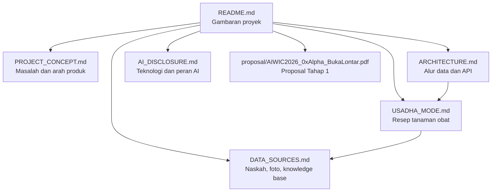

# Dokumentasi BukaLontar

Dokumentasi ini menjelaskan produk, arsitektur, alur AI, dan batasan BukaLontar. Semua halaman ditulis dalam Markdown agar dapat dibaca langsung di GitHub maupun di Obsidian.

Snapshot dokumentasi: 12 November 2026. Tag final submission: [`v1.1-final-submission`](https://github.com/0xMinomus/bukalontar/tree/v1.1-final-submission). Tag ini membekukan source code dan dokumentasi; tidak menjamin akurasi AI atau kesamaan commit deployment produksi.

## Mulai di sini

1. [Status proyek](STATUS.md) untuk kondisi akhir, bukti pengujian, dan batasan.
2. [README proyek](../README.md) untuk gambaran umum dan cara menjalankan aplikasi.
3. [Konsep produk](PROJECT_CONCEPT.md) untuk masalah, target pengguna, dan arah produk.
4. [Arsitektur](ARCHITECTURE.md) untuk alur data dan kontrak API.
5. [Alur Usadha](USADHA_MODE.md) untuk pengaman kutipan dan kartu resep.
6. [Sumber data](DATA_SOURCES.md) untuk rujukan naskah, foto, dan knowledge base.
7. [AI Disclosure](AI_DISCLOSURE.md) untuk teknologi dan peran AI.
8. [Proposal PDF tahap 1](proposal/AIWIC2026_0xAlpha_BukaLontar.pdf) sebagai dokumen historis, bukan spesifikasi implementasi akhir.
9. [Evaluasi AI](AI_EVALUATION.md#upgrade-pengaman-kutipan-dan-pembanding-baseline) untuk perbandingan baseline terakhir dan artefak mentah.
10. [Detektor teks dan pengenal glif](OCR_TRAINING.md) untuk model lokal, metrik, dan cara melatih ulang.

## Peta dokumen

## Prinsip dokumentasi

- Klaim produk harus sesuai dengan kode yang ada.
- Batasan dan hal yang belum tersedia ditulis terbuka.
- Rujukan naskah dan aset pihak ketiga mencantumkan sumber.
- Dokumentasi tidak menyimpan API key, token, atau data pribadi.
- Hasil eksperimen lama dipertahankan sebagai riwayat. Untuk laporan akhir, gunakan bagian upgrade terakhir, bukan angka terbaik yang dipilih dari percobaan berbeda.
- Kelayakan alur aplikasi dibedakan dari akurasi bacaan. Pengaman resep membaik; akurasi pembacaan dan penolakan aksara belum terbukti meningkat.
