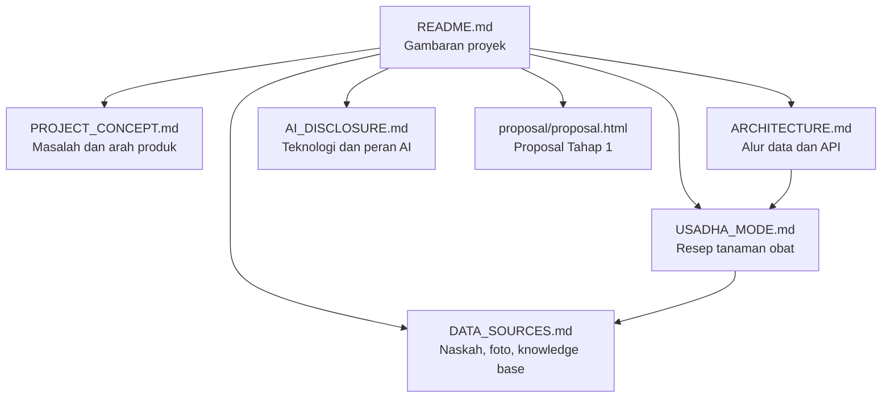

# Dokumentasi BukaLontar

Dokumentasi ini menjelaskan produk, arsitektur, alur AI, dan batasan BukaLontar. Semua halaman ditulis dalam Markdown agar dapat dibaca langsung di GitHub maupun di Obsidian.

## Mulai di sini

1. [README proyek](../README.md) untuk gambaran umum dan cara menjalankan aplikasi.
2. [Konsep produk](PROJECT_CONCEPT.md) untuk masalah, target pengguna, dan arah produk.
3. [Arsitektur](ARCHITECTURE.md) untuk alur data dan kontrak API.
4. [Alur Usadha](USADHA_MODE.md) untuk fitur resep tanaman obat.
5. [Sumber data](DATA_SOURCES.md) untuk rujukan naskah, foto, dan knowledge base.
6. [AI Disclosure](AI_DISCLOSURE.md) untuk teknologi dan peran AI.
7. [Proposal Tahap 1](proposal/proposal.html) untuk versi proposal yang dapat dicetak.
8. [Proposal PDF](proposal/AIWIC2026_0xAlpha_BukaLontar.pdf) untuk file submission.
9. [Audit proposal](proposal/AUDIT.md) untuk catatan pemeriksaan dokumen.

## Peta dokumen

## Prinsip dokumentasi

- Klaim produk harus sesuai dengan kode yang ada.
- Batasan dan hal yang belum tersedia ditulis terbuka.
- Rujukan naskah dan aset pihak ketiga mencantumkan sumber.
- Dokumentasi tidak menyimpan API key, token, atau data pribadi.
